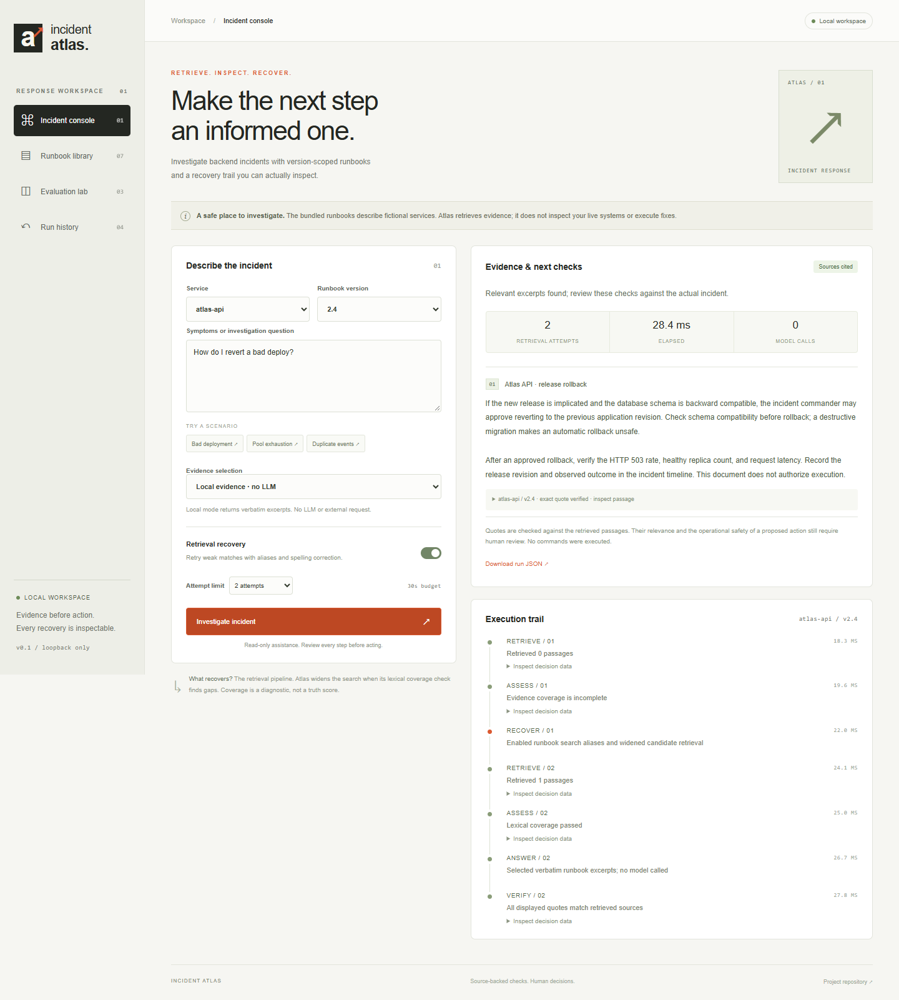

# Incident Atlas

**An inspectable incident-response evidence assistant for backend teams.**

An engineer sees HTTP 503s after a release, pool checkout timeouts, or an event arriving twice.
The relevant runbook may use different terminology or describe an older version of the service.
Atlas isolates the correct service/version, retrieves evidence, retries weak lexical matches,
and shows which passages and recovery decisions produced the result.

This upgrades the original Self-RAG notebook into a runnable local application. The original
notebooks remain unchanged; their setup and limitations are in [Notebook experiments](docs/NOTEBOOKS.md).



## Run locally

Python 3.10 or newer. No API key or model download is needed for the default extractive mode.

```powershell
git clone https://github.com/nischay1277/langgraph-nischay.git
cd langgraph-nischay
python -m venv .venv
.\.venv\Scripts\python.exe -m pip install -r requirements.lock
.\.venv\Scripts\python.exe -m incident_atlas
```

Open **http://127.0.0.1:8765**. On this checkout, double-click `start.bat` or run `./start.ps1`
after setup. Press Ctrl+C to stop. On macOS/Linux, use `.venv/bin/python` in place of the
Windows Python path. Run from the repository root, or install with `pip install -e .`.

The first launch seeds seven synthetic runbooks for fictional Atlas API and Ledger worker
services. Later launches preserve the workspace, including deleted documents. Use **Load demo
runbooks** to restore missing examples. Local data lives in ignored `data/atlas.sqlite3`.

## What you can inspect

| Workspace | Implemented behavior |
| --- | --- |
| Incident console | Service/version selection, baseline/recovery toggle, attempt budget, exact source quotes and executed-stage timeline |
| Runbook library | UTF-8 TXT/Markdown and text-layer PDF uploads, aliases, content deduplication and document removal |
| Evaluation lab | Paired baseline/recovery runs on 14 fixed synthetic cases; inspect either path for each case and export JSON |
| Run history | Persistent query/configuration/evidence snapshots and downloadable run records |

Try **“How do I revert a bad deploy?”** under `atlas-api` / `2.4`, first without recovery and
then with it. The recovery trail shows metadata aliases and wider retrieval. Try the
misspelled **“How do I investigate conection pool exhuastion?”**, or select `ledger-worker` /
`3.1` and ask **“Why are events arriving twice?”**. See the [five-minute demo](docs/DEMO.md).

## How the recovery works

```text
Question + service/version
  -> BM25 retrieve -> lexical coverage assessment
       -> sufficient: select evidence -> validate exact quotes -> publish excerpts
       -> insufficient: aliases + spelling correction + wider retrieval -> reassess
       -> no sufficient evidence within budget: abstain
```

- Actual LangGraph state machine; one to three retrieval attempts, at most one model call.
- Hard service/version filters precede ranking; no silent fallback to another version.
- Every displayed quote must occur in a retrieved passage with an allowed chunk identifier.
- Optional model failure or invalid citation falls back to local excerpts and records the error.
- A model's explicit no-evidence decision is respected.
- No execution tools exist. Atlas does not modify servers, execute fixes, or confirm root causes.

Retrieval currently uses **lexical BM25 and metadata aliases, not vector embeddings**.
Lexical coverage is a heuristic, not confidence in correctness. Even a real quote may be
irrelevant, outdated or unsafe to follow. This implementation publishes excerpts rather than
unverified generated summaries. The optional LLM selects evidence; its paraphrases are discarded.

## Optional model selection

Copy `.env.example` to `.env` and set the appropriate variables. Restart the server afterward.

| Provider | Server configuration | Data flow |
| --- | --- | --- |
| Local extractive | None | No model/network request |
| OpenAI | `OPENAI_API_KEY` and `OPENAI_MODEL` supporting Responses structured outputs | Sends question and retrieved passages to OpenAI; usage is recorded |
| Ollama | `OLLAMA_MODEL`, with that model installed and Ollama running | Uses fixed `http://127.0.0.1:11434/api/chat` |

Credentials are never returned to the browser. These adapters have mocked integration tests;
live OpenAI and Ollama inference require your own configured provider and are not represented
as verified by the offline test suite. Model selection can incur provider charges.

## Tests and evaluation

```powershell
.\.venv\Scripts\python.exe -m pytest -q
.\.venv\Scripts\python.exe -m pip check
```

Tests cover retrieval recovery, unknowns, version isolation, quote forgery, model failures,
abstention, upload errors, persistence, local-origin boundaries, and provider request formats.
The `requirements.lock` file pins the verified runtime and test environment. `pyproject.toml`
also supports editable installation for development.

With the server running, optional browser checks use an installed Chrome:

```powershell
.\.venv\Scripts\python.exe -m pip install playwright==1.64.1
.\.venv\Scripts\python.exe scripts/check_ui.py
```

Set `ATLAS_CHROME` to the browser executable on other systems. This checks both retrieval
paths, history, the library, evaluation and mobile overflow. It writes screenshots under
`docs/screenshots/`. No Playwright-managed browser download is required.

The Evaluation lab uses development fixtures that informed the implementation. It reports
expected-source recall, expected-source citation rate and unknown-question abstention,
**not production accuracy, factual correctness or proven incident resolution**. The complete
unmodified demo scope is required. See [architecture and limitations](docs/ARCHITECTURE.md).

## Project layout

```text
incident_atlas/
  app.py          FastAPI API and loopback workspace boundary
  engine.py       Bounded LangGraph retrieval/recovery workflow
  retrieval.py    BM25, spelling variants and excerpt selection
  providers.py    Optional server-side OpenAI / Ollama adapters
  store.py        SQLite documents, chunks and evidence snapshots
  evaluation.py   Paired fixture evaluation and demo seeding
  demo/           Synthetic runbooks and labeled development cases
  static/         Responsive browser workbench; no frontend build step
tests/            Backend, API and mocked-provider tests
scripts/          Real-browser smoke check
self_rag.ipynb    Original exploratory notebook
workflows/        Original LangGraph learning notebooks
```

## Operational scope

Use redacted, trusted local documents. The app binds to loopback and includes Host/Origin
checks, a per-process mutation token, safe text rendering and a same-origin CSP. It is a
single-user local tool, with no account authentication, encrypted storage or execution sandbox
for hostile PDFs. Do not expose it as a public or shared service. Run snapshots retain source
text after a document is removed; the UI does not yet provide per-run retention controls.

Meaningful next improvements require evidence: independently labeled real incidents,
held-out evaluation, semantic retrieval/reranking comparisons, document supersession and
conflict detection, then structured telemetry ingestion. Automatic remediation would need
a separate, explicitly authorized execution system.
