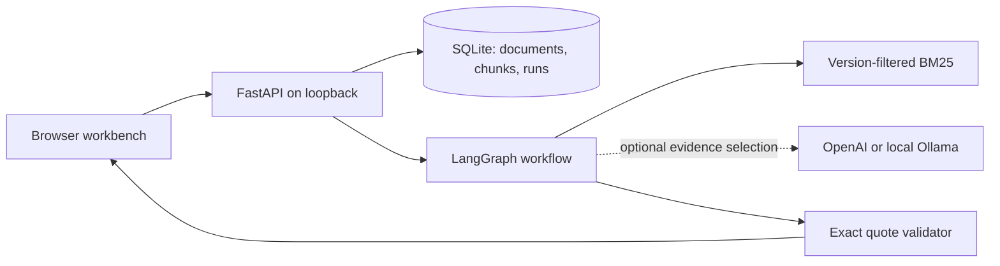
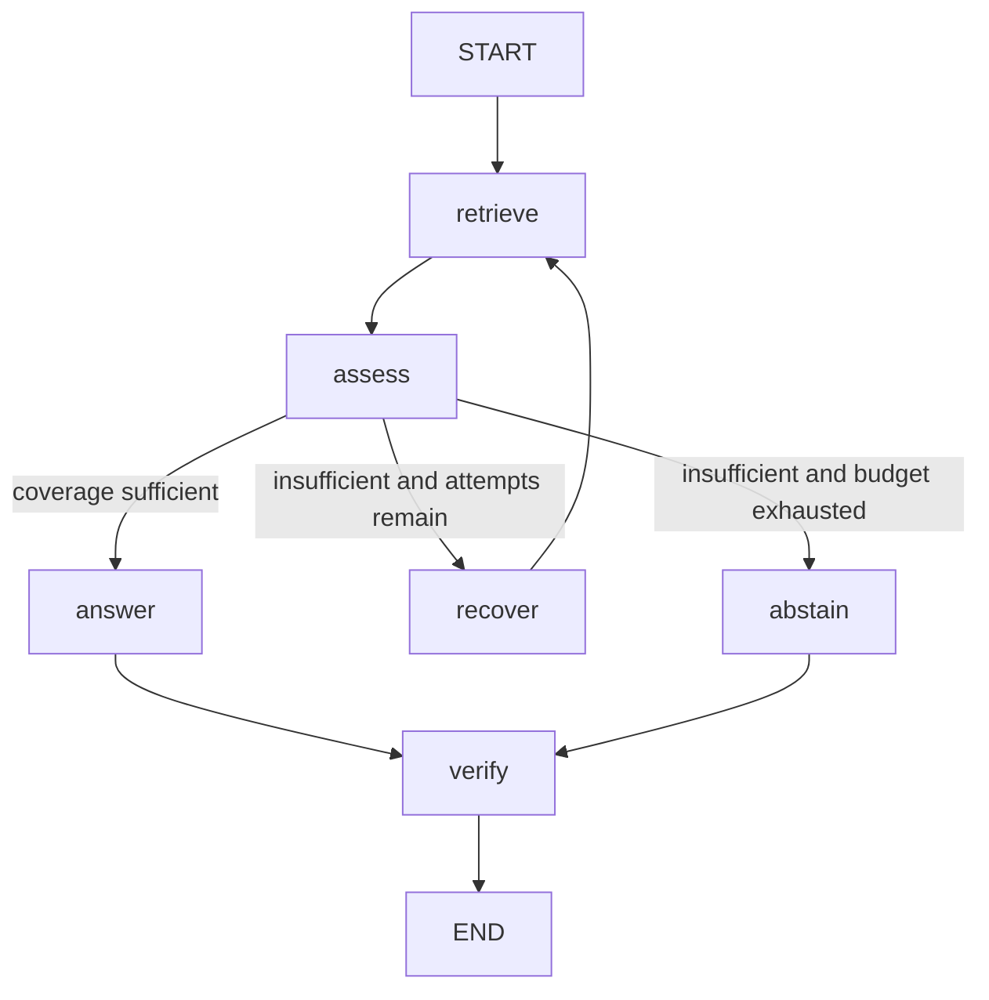

# Incident Atlas architecture

## Problem and boundary

An on-call engineer has an incident symptom and a folder of runbooks. The symptom may use
different language from the document. A superficially relevant result may describe the wrong
service or retired deployment version. Atlas provides an inspectable evidence-selection
workflow for this problem. It does not receive live telemetry or establish a root cause.

The bundled Atlas API and Ledger worker services are fictional. Their incidents are synthetic.
Upload redacted runbooks for a real service to use the same workflow on actual documentation.

## Components

## Ingestion and retrieval

- The application extracts UTF-8 text or text-layer PDF content. PDFs retain page markers;
  character offsets locate normalized passages. OCR, tables, images and layout understanding
  are outside this implementation.
- Content hashes deduplicate documents within a service/version pair. Ingesting a revised
  document adds another document; explicitly remove obsolete revisions from that scope.
- Paragraph-aware windows have a maximum of 1,100 characters and 160-character overlap.
- Service and version are exact filters applied **before** ranking. A nonexistent version
  yields no candidates, rather than silently searching other versions.
- Baseline uses BM25 over passage text, with three candidates. Recovery also searches
  user-supplied document aliases, corrects close spelling variants, and widens the candidate
  set by two per retry (up to eight). These are lexical techniques, not semantic embeddings.
- Coverage is the fraction of non-stopword query terms matched across candidates. At 0.6,
  the pipeline allows evidence selection. This is a heuristic gate, not calibrated
  relevance, factual confidence or an answer-completeness guarantee. Unrelated passages
  with coincidental word overlap can pass; operational review remains essential.

## Answer provenance and failures

Default mode selects verbatim paragraphs without an LLM. Optional models return a JSON
schema containing claims, chunk identifiers and supporting quotes. The application checks
identifiers and exact quote membership. **Only the quotes are published**; generated
paraphrases are discarded because quote membership alone cannot prove entailment.

If a provider fails or returns an invalid citation, the workflow records the failure and
falls back to local excerpts. If the model explicitly abstains, that abstention is respected.
Without sufficient retrieval evidence, it publishes no answer. Each run makes at most one
model call and one to three retrieval attempts. The default time budget is 30 seconds,
checked between stages. HTTP phase timeouts are capped by the remaining budget; they
are not hard process-level cancellation, so a blocked or slowly streaming call can overrun.

No shell tools, URL fetching, server changes or automated remediation exist. A source
may itself contain harmful operational advice: provenance does not establish correctness
or safety. Documents remain untrusted data even when quoted.

## Storage and local security

SQLite uses foreign keys and WAL. Runs retain their evidence and configuration as immutable
JSON snapshots. Removing a document removes its chunks but does not redact past snapshots.
Deleting sensitive data from saved runs currently requires workspace-level data management;
there is no per-run retention UI. Local data is not encrypted by the application.

The launcher binds to `127.0.0.1`, enforces localhost/loopback Host headers, rejects foreign
Origins and requires a per-process workspace token for mutations. No cross-origin resource
sharing is enabled. The browser renders document/model text with `textContent`, with a
same-origin CSP and no third-party assets. Uploads have size/type/page/count limits and
require Content-Length. PDF extraction is not sandboxed against CPU-intensive malformed
files. This is a single-user trusted-local application, not a multi-user authenticated service.
Other local processes can access the workspace; do not expose it through a public tunnel.

External calls occur only when a configured provider is selected. OpenAI receives the query
and retrieved passage text; Ollama uses a fixed loopback endpoint. Credentials remain in
server environment variables. Error responses omit provider response bodies and headers.

## Evaluation and limitations

Fourteen fixed, synthetic development cases cover exact matches, aliases, misspellings,
version boundaries, duplicate delivery, and missing information. Both paths use local
extractive mode on the same corpus. The UI reports source recall, expected-source citation
rate and abstention on unanswerable cases. Recovery changes multiple retrieval settings at
once, so the comparison is not an ablation proving which technique caused an improvement.

The fixtures informed implementation and are not held-out evaluation. A production study
needs independently labeled incidents, held-out questions, relevance judgments, harmful-
recommendation checks, and workload/latency tests. No production accuracy, token cost or
security guarantee is inferred from these fixtures.

Useful next steps: independently reviewed incident data; semantic retrieval with measured
recall gains; reranking; temporal supersession metadata; conflict detection; structured log
ingestion; explicit approval boundaries before any future operational tool execution.
